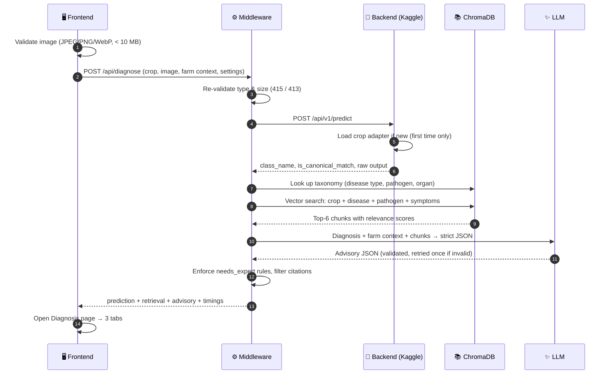
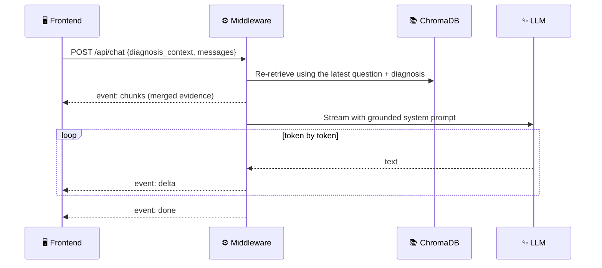

<div align="center">

# 🌱 SAGE — How It Works

**Smart Agricultural Generative Expert**
*Photo of a leaf in → diagnosis, grounded treatment advice and an AI agronomist out.*

`React + Vite` · `FastAPI` · `Qwen2.5-VL-3B + LoRA` · `ChromaDB` · `Gemini / Claude`

</div>

---

## 📑 Contents

1. [The big picture](#-1-the-big-picture)
2. [What happens when you click "Diagnose Crop"](#-2-what-happens-when-you-click-diagnose-crop)
3. [What happens when you chat with the AI Agronomist](#-3-what-happens-when-you-chat-with-the-ai-agronomist)
4. [Running the whole system](#-4-running-the-whole-system)
5. [File-by-file guide](#-5-file-by-file-guide)
6. [Key design decisions](#-6-key-design-decisions)
7. [Troubleshooting](#-7-troubleshooting)

---

## 🗺️ 1. The big picture

SAGE is split into **three services**. Each one has a single job, and the browser only ever talks to the middleware.


| Layer | Where it runs | Its job | Why it's separate |
|---|---|---|---|
| 🖥️ **Frontend** | Your PC, `localhost:5173` | Collects the photo + context, shows results, streams the chat | No secrets in the browser; pure UI |
| ⚙️ **Middleware** | Your PC, `localhost:8001` | Orchestrates the pipeline: validate → predict → retrieve → advise | Holds every API key; one place for error handling |
| 🧠 **Backend** | Kaggle T4 GPU (cloud) | Runs the vision model and swaps crop adapters | Needs a GPU; its public URL changes every session |
| 📚 **ChromaDB** | `middleware/chroma_db/` | Agronomy knowledge base for retrieval | 1.7 GB local vector store, never committed |
| ✨ **LLM** | Google / Anthropic API | Turns diagnosis + knowledge into readable advice | Swappable via one `.env` setting |

---

## 🔬 2. What happens when you click "Diagnose Crop"



### Step by step

| # | Stage | What happens | File |
|:-:|---|---|---|
| 1 | **Pick & upload** | User picks a crop, drops a photo, optionally fills farm context | `CropSelector.tsx`, `ImageDropzone.tsx`, `FarmContextForm.tsx` |
| 2 | **Send** | Browser builds a multipart form and calls the middleware | `services/api.ts` |
| 3 | **Validate** | Middleware rejects bad types (415) or oversized files (413) *before* using the GPU | `routes/diagnose.py` |
| 4 | **Predict** | Image goes to the Kaggle GPU. The crop's LoRA adapter is attached on first use, then kept in memory | `clients/backend.py` → `sage_inference_server.ipynb` |
| 5 | **Enrich** | The model only returns a class name, so disease type / pathogen / organ are looked up from ChromaDB metadata | `rag/retriever.py → taxonomy()` |
| 6 | **Retrieve** | The diagnosis is embedded with `all-MiniLM-L6-v2` and the 6 closest chunks for that crop are fetched. *Skipped for "Healthy".* | `rag/retriever.py → query()` |
| 7 | **Advise** | The LLM writes a JSON advisory using **only** the diagnosis, farm context and chunks | `llm/advisory.py` |
| 8 | **Safety rules** | `needs_expert = true` if the class isn't canonical, no chunk scores ≥ `RAG_MIN_SCORE`, or severity is high | `routes/diagnose.py` |
| 9 | **Show** | The app switches to the Diagnosis page with three tabs | `App.tsx`, `ResultsDashboard.tsx` |

> [!TIP]
> **Graceful degradation:** if retrieval or the LLM fails, the middleware still returns the prediction with a `partial_failure` note. Tab 1 always works; Tabs 2–3 explain what's missing.

### The three result tabs

| Tab | Shows | Component |
|---|---|---|
| 🔬 **Visual Diagnosis** | Disease badge, canonical-match pill, type / organ / pathogen / symptoms, telemetry, raw output + JSON | `PredictionResult.tsx` |
| 🩺 **Treatment & Knowledge** | Expert warning, severity meter, chemical / organic / cultural treatments, prevention, conditions, numbered citations, expandable evidence | `TreatmentAdvisory.tsx` |
| 🤖 **AI Agronomist** | Advisory summary, suggested questions built from the diagnosis, streaming chat | `AgronomistChat.tsx` |

---

## 💬 3. What happens when you chat with the AI Agronomist



- **Streaming** uses Server-Sent Events, so words appear as they're generated.
- **Grounding:** facts come from the retrieved chunks and are cited as `[chunk_id]`. The UI renders these as small numbered chips, never raw ids.
- **Tone:** direct, practical, bullet points, bold key action. No "the sources don't say…" meta-talk.
- **Safety:** never invents dosages; points to a local extension officer for dosages and risky cases; recommends only, never claims to act.

---

## ▶️ 4. Running the whole system

> [!IMPORTANT]
> Start in this order: **Backend → Middleware → Frontend.**

### ① Backend (Kaggle)

1. Import `backend/sage_inference_server.ipynb` into Kaggle.
2. Settings → **GPU T4 x2**, **Internet On**. Add secret **`HF_TOKEN`** (optional `SAGE_API_KEY`).
3. **Run All** → copy the printed line:
   ```text
   BACKEND_URL=https://xxxx.trycloudflare.com
   ```

### ② Middleware

```powershell
cd middleware
.venv\Scripts\activate
# paste BACKEND_URL into middleware/.env
uvicorn app.main:app --reload --port 8001
```
✅ First log line shows `backend_url=… llm_provider=…` · health at <http://localhost:8001/api/health>

### ③ Frontend

```powershell
cd frontend
npm run dev
```
✅ Open <http://localhost:5173> — all header badges should turn green within 30 s.

> [!NOTE]
> **Every new Kaggle session = a new tunnel URL.** Update `BACKEND_URL` in `middleware/.env` and restart uvicorn.

---

## 📂 5. File-by-file guide

```text
sage-app/
├── backend/        🧠 GPU inference server (runs on Kaggle)
├── middleware/     ⚙️ FastAPI orchestrator (runs locally)
├── frontend/       🖥️ React web app (runs locally)
├── docs/           📘 This guide
├── README.md       Setup & environment variables
├── CLAUDE.md       Conventions for AI-assisted development
└── .gitignore      Keeps secrets, models and the vector DB out of git
```

### 🧠 `backend/`

| File | What it is | Why we created it |
|---|---|---|
| `sage_inference_server.ipynb` | The cloud GPU server. Loads Qwen2.5-VL once, attaches per-crop LoRA adapters on demand, serves the API, opens a Cloudflare tunnel | Free GPUs live in notebooks; this turns one into an API the middleware can call |
| `modelpath.txt` | Maps each crop to its adapter folder in the HF repo | One editable source of truth for adapter locations |
| `.env.example` | Template for `HF_TOKEN` and `SAGE_API_KEY` | Documents secrets without committing them |
| `testing -latest.ipynb` | Original evaluation notebook | Reference for the prompt style and loading code that are known to work |

<details>
<summary><b>Inside the notebook — cell by cell</b></summary>

| Cell | Purpose |
|:-:|---|
| 1 | Install `transformers`, `peft`, `fastapi`, `uvicorn` |
| 2 | Read `modelpath.txt`, load `HF_TOKEN` / `SAGE_API_KEY` from Kaggle Secrets → Colab → env → `.env` |
| 3 | Crop registry: class lists + the evaluation-style default prompt |
| 4 | Load the processor and fp16 base model (Kaggle mount, else Hub) |
| 5 | `AdapterManager` — downloads, attaches and switches adapters; a GPU lock serialises requests |
| 6 | Inference + parser that matches output to a known class (`is_canonical_match`) |
| 7 | FastAPI app: `/health`, `/api/v1/crops`, `/api/v1/model/status`, `/api/v1/predict` |
| 8 | Starts uvicorn in a thread + the Cloudflare tunnel, prints `BACKEND_URL` |
| 9 | Smoke-tests the public URL |
| 10 | Optional keep-alive status log |

</details>

### ⚙️ `middleware/`

| File | What it does | Why it exists |
|---|---|---|
| `app/main.py` | Creates the FastAPI app, CORS, request logging, error handlers; logs the active config at startup | Single entry point for `uvicorn app.main:app` |
| `app/config.py` | Typed settings loaded from `middleware/.env` (absolute path) | Every tunable value in one place; works from any working directory |
| `app/errors.py` | `APIError` → JSON `{error, detail}` | The frontend can always show a clean message |
| `app/schemas.py` | Pydantic models: `Advisory`, `RetrievedChunk`, `DiagnoseResponse`, `ChatRequest`… | Validates LLM JSON and defines the API contract |
| `app/clients/backend.py` | Async HTTP client for the GPU backend; maps timeouts → 504, tunnel down → 502 | Isolates all tunnel quirks in one file |
| `app/rag/retriever.py` | Opens ChromaDB, embeds queries with `all-MiniLM-L6-v2`, crop-filtered search, taxonomy lookup | Retrieval-augmented generation — advice grounded in real data |
| `app/llm/base.py` | Abstract `LLMProvider` (`complete`, `stream`) | Lets us switch providers without touching routes |
| `app/llm/gemini.py` | Gemini provider: 90 s timeout, low thinking, model fallback + 2-min cooldown for busy models | Survives 429 / 503 / 504 from busy Gemini models |
| `app/llm/anthropic.py` | Claude provider | Alternative provider via `LLM_PROVIDER=anthropic` |
| `app/llm/factory.py` | Builds the configured provider; reports provider/model for the health badge | One switch point |
| `app/llm/advisory.py` | Advisory + chat system prompts, context builder, JSON parsing with one retry, citation filtering | All prompt engineering lives here |
| `app/routes/system.py` | `/api/health`, `/api/crops` (5-min cache), `/api/model/status` | Powers the header badges; health never crashes |
| `app/routes/diagnose.py` | The full diagnosis pipeline + `needs_expert` rules + partial-failure handling | The heart of the system |
| `app/routes/chat.py` | `/api/chat` with re-retrieval and SSE streaming | Live follow-up conversation |
| `tests/test_api.py` | 9 pytest tests with the backend, ChromaDB and LLM mocked | Verifies the pipeline offline in < 1 s |
| `requirements.txt` · `pytest.ini` · `.env.example` | Dependencies, test config, settings template | Reproducible setup |
| `chroma_db/` *(git-ignored)* | The 1.7 GB vector store | Copied from Drive; too large for git |

### 🖥️ `frontend/`

| File | What it does | Why it exists |
|---|---|---|
| `index.html` | Page shell, fonts (Fraunces + Inter), favicon | Vite entry |
| `vite.config.ts` · `tsconfig.json` · `package.json` | Build tooling, TypeScript, dependencies | Standard Vite + React + Tailwind v4 setup |
| `.env.example` | `VITE_MIDDLEWARE_URL` | The **only** frontend setting — no secrets |
| `src/main.tsx` | Mounts `<App />` | React entry point |
| `src/index.css` | Theme tokens (moss / soil / wheat / clay), animations, global text wrapping, reduced-motion support | One consistent visual language |
| `src/App.tsx` | State, health polling (30 s), crop loading, the **Input** and **Diagnosis** views (`#/diagnosis`) | Orchestrates the whole UI |
| `src/types/sage.ts` | TypeScript interfaces for every backend + middleware response | Type safety end to end |
| `src/services/api.ts` | The only module that calls `fetch`; friendly messages per status code; SSE parser for chat | Keeps networking out of components |

<details open>
<summary><b>Components (<code>src/components/</code>)</b></summary>

| Component | Role |
|---|---|
| `Header.tsx` | Branding + live status badges: backend, adapter, GPU memory, knowledge base, LLM |
| `CropSelector.tsx` | Crop cards with emoji, known-class tag cloud, adapter loading status |
| `ImageDropzone.tsx` | Drag-and-drop / browse / mobile camera, preview, replace & clear, client-side validation |
| `FarmContextForm.tsx` | Growth stage, soil, weather, past treatments, notes |
| `AdvancedSettings.tsx` | Collapsible prompt, temperature and token controls |
| `RunProgress.tsx` | Elapsed timer + stage labels while diagnosing |
| `ResultsDashboard.tsx` | Accessible tabs with a sliding indicator and arrow-key navigation |
| `PredictionResult.tsx` | Tab 1 — visual diagnosis and telemetry |
| `TreatmentAdvisory.tsx` | Tab 2 — advisory, severity, citations, expandable evidence |
| `AgronomistChat.tsx` | Tab 3 — context-aware suggested questions and streaming chat |
| `RichText.tsx` | Renders LLM text: **bold**, bullets, and `[chunk_id]` → numbered citation chips |
| `Toasts.tsx` | Non-blocking success / error / info notifications |

</details>

### 📄 Root files

| File | Purpose |
|---|---|
| `README.md` | Setup steps, every environment variable, API table |
| `CLAUDE.md` | Project structure and conventions for AI-assisted coding |
| `.gitignore` | Excludes `.env`, `chroma_db/`, model weights, `node_modules`, `.venv` |
| `docs/WORKFLOW.md` | This guide |

---

## 🧭 6. Key design decisions

| Decision | Reason |
|---|---|
| **Middleware between UI and GPU** | Secrets stay server-side; the tunnel URL changes without touching the frontend |
| **Adapters loaded on demand** | One base model in GPU memory; each crop costs only a small LoRA download the first time |
| **Evaluation-style prompt** | The adapters were tested with "choose exactly one class…" — reusing it keeps accuracy |
| **Own embeddings for ChromaDB** | Newer Chroma rejects a different embedding function; computing vectors ourselves avoids the conflict |
| **Strict JSON advisory + one retry** | Structured output renders reliably in Tab 2 |
| **Citations filtered to retrieved ids** | The LLM can't cite sources that don't exist |
| **`needs_expert` enforced server-side** | Safety doesn't depend on the LLM's judgement |
| **Partial failure instead of errors** | A slow LLM never hides a successful diagnosis |
| **Model fallback + cooldown** | Busy or rate-limited Gemini models are skipped automatically |

---

## 🛠️ 7. Troubleshooting

| Symptom | Likely cause | Fix |
|---|---|---|
| 🔴 **Backend offline** badge | Kaggle session ended or wrong URL | Re-run the notebook, update `BACKEND_URL`, restart uvicorn |
| LLM badge shows the wrong provider | Values were put in `.env.example`, not `.env` | Edit `middleware/.env`; check the startup log line |
| **Knowledge error** | ChromaDB folder missing or wrong path | Ensure `middleware/chroma_db/` exists; check `CHROMA_PATH` |
| `429` / `503` from Gemini | Model busy or free-tier limit | Automatic fallback; or set `GEMINI_MODEL=gemini-3.5-flash-lite` |
| `504 DEADLINE_EXCEEDED` | LLM call exceeded the timeout | Raise `LLM_TIMEOUT_S` in `.env` |
| First diagnosis is slow | Adapter download + embedding model load | Normal — later requests for the same crop are fast |
| Diagnosis "Not reported" fields | That disease has no taxonomy data in the store | Expected; the advisory still works |

<div align="center">

---

*SAGE gives recommendations only. Always confirm product choice and dosage with a local agricultural extension officer.*

</div>
