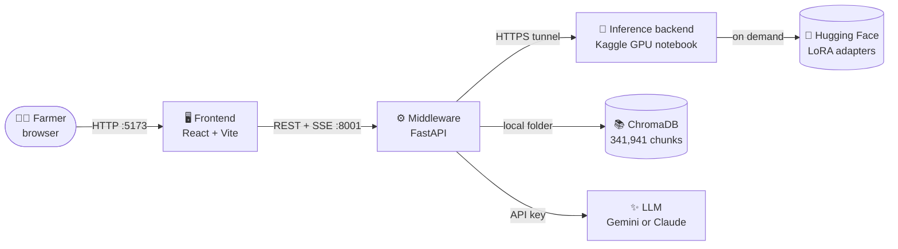
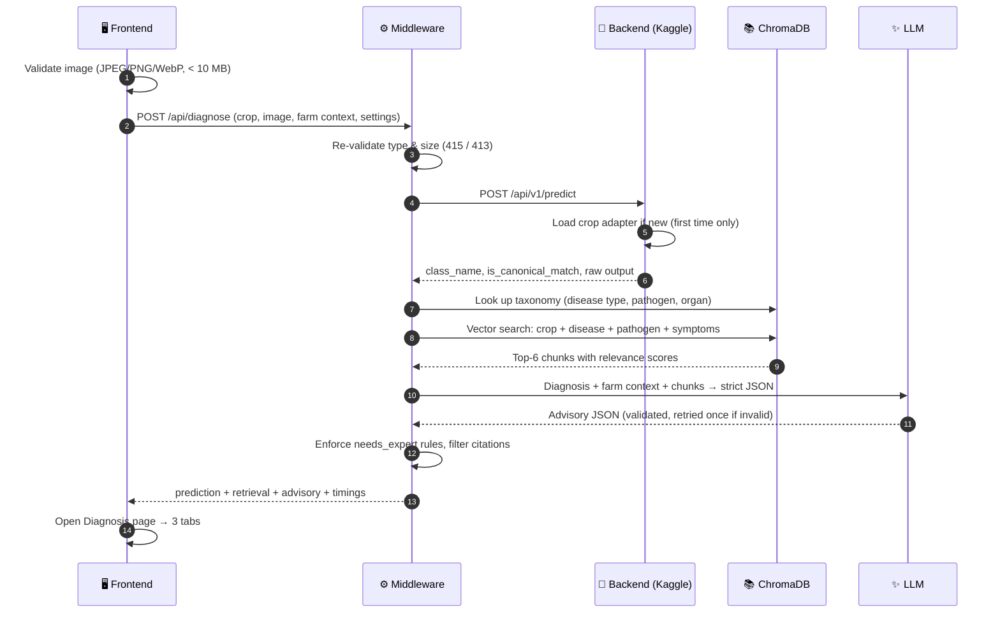
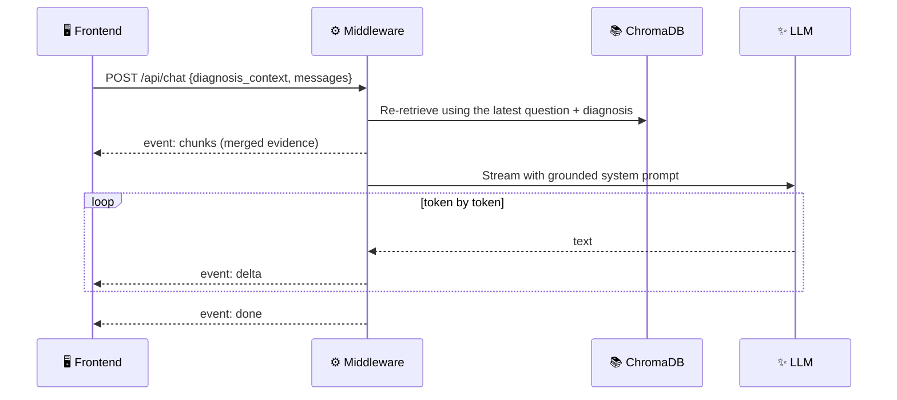
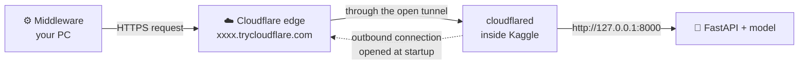
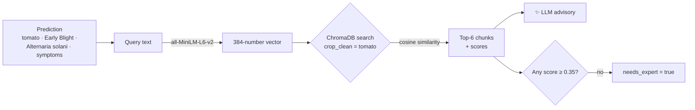
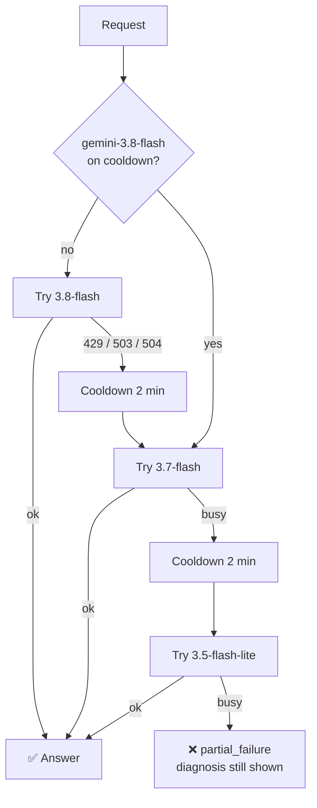

<div align="center">

# 🌱 SAGE — How It Works

**Smart Agricultural Generative Expert**
*Photo of a leaf in → diagnosis, grounded treatment advice and an AI agronomist out.*

`React + Vite` · `FastAPI` · `Qwen2.5-VL-3B + LoRA` · `ChromaDB` · `Gemini / Claude`

</div>

---

## 📑 Contents

1. [The big picture](#-1-the-big-picture)
2. [What happens when you click "Diagnose Crop"](#-2-what-happens-when-you-click-diagnose-crop)
3. [What happens when you chat with the AI Agronomist](#-3-what-happens-when-you-chat-with-the-ai-agronomist)
4. [Under the hood: Cloudflare, LoRA, vector DB, Gemini](#-4-under-the-hood)
5. [Running the whole system](#-5-running-the-whole-system)
6. [File-by-file guide](#-6-file-by-file-guide)
7. [Key design decisions](#-7-key-design-decisions)
8. [Troubleshooting](#-8-troubleshooting)

---

## 🗺️ 1. The big picture

SAGE is split into **three services**. Each one has a single job, and the browser only ever talks to the middleware.



| Layer | Where it runs | Its job | Why it's separate |
|---|---|---|---|
| 🖥️ **Frontend** | Your PC, `localhost:5173` | Collects the photo + context, shows results, streams the chat | No secrets in the browser; pure UI |
| ⚙️ **Middleware** | Your PC, `localhost:8001` | Orchestrates the pipeline: validate → predict → retrieve → advise | Holds every API key; one place for error handling |
| 🧠 **Backend** | Kaggle T4 GPU (cloud) | Runs the vision model and swaps crop adapters | Needs a GPU; its public URL changes every session |
| 📚 **ChromaDB** | `middleware/chroma_db/` | Agronomy knowledge base for retrieval | 1.7 GB local vector store, never committed |
| ✨ **LLM** | Google / Anthropic API | Turns diagnosis + knowledge into readable advice | Swappable via one `.env` setting |

---

## 🔬 2. What happens when you click "Diagnose Crop"



### Step by step

| # | Stage | What happens | File |
|:-:|---|---|---|
| 1 | **Pick & upload** | User picks a crop, drops a photo, optionally fills farm context | `CropSelector.tsx`, `ImageDropzone.tsx`, `FarmContextForm.tsx` |
| 2 | **Send** | Browser builds a multipart form and calls the middleware | `services/api.ts` |
| 3 | **Validate** | Middleware rejects bad types (415) or oversized files (413) *before* using the GPU | `routes/diagnose.py` |
| 4 | **Predict** | Image goes to the Kaggle GPU. The crop's LoRA adapter is attached on first use, then kept in memory | `clients/backend.py` → `sage_inference_server.ipynb` |
| 5 | **Enrich** | The model only returns a class name, so disease type / pathogen / organ are looked up from ChromaDB metadata | `rag/retriever.py → taxonomy()` |
| 6 | **Retrieve** | The diagnosis is embedded with `all-MiniLM-L6-v2` and the 6 closest chunks for that crop are fetched. *Skipped for "Healthy".* | `rag/retriever.py → query()` |
| 7 | **Advise** | The LLM writes a JSON advisory using **only** the diagnosis, farm context and chunks | `llm/advisory.py` |
| 8 | **Safety rules** | `needs_expert = true` if the class isn't canonical, no chunk scores ≥ `RAG_MIN_SCORE`, or severity is high | `routes/diagnose.py` |
| 9 | **Show** | The app switches to the Diagnosis page with three tabs | `App.tsx`, `ResultsDashboard.tsx` |

> [!TIP]
> **Graceful degradation:** if retrieval or the LLM fails, the middleware still returns the prediction with a `partial_failure` note. Tab 1 always works; Tabs 2–3 explain what's missing.

### The three result tabs

| Tab | Shows | Component |
|---|---|---|
| 🔬 **Visual Diagnosis** | Disease badge, canonical-match pill, type / organ / pathogen / symptoms, telemetry, raw output + JSON | `PredictionResult.tsx` |
| 🩺 **Treatment & Knowledge** | Expert warning, severity meter, chemical / organic / cultural treatments, prevention, conditions, numbered citations, expandable evidence | `TreatmentAdvisory.tsx` |
| 🤖 **AI Agronomist** | Advisory summary, suggested questions built from the diagnosis, streaming chat | `AgronomistChat.tsx` |

---

## 💬 3. What happens when you chat with the AI Agronomist



- **Streaming** uses Server-Sent Events, so words appear as they're generated.
- **Grounding:** facts come from the retrieved chunks and are cited as `[chunk_id]`. The UI renders these as small numbered chips, never raw ids.
- **Tone:** direct, practical, bullet points, bold key action. No "the sources don't say…" meta-talk.
- **Safety:** never invents dosages; points to a local extension officer for dosages and risky cases; recommends only, never claims to act.

---

## 🧩 4. Under the hood

Four technologies make SAGE work. Each part below starts with the **key points**, then explains them.

### 4.1 ☁️ Cloudflare Tunnel: how the Kaggle GPU gets a public URL

> [!NOTE]
> **Key points**
> - Kaggle notebooks have **no public IP and no open ports**, so nothing outside can call them directly.
> - `cloudflared` opens an **outbound** connection from Kaggle to Cloudflare, and Cloudflare gives it a public HTTPS address.
> - We use a free **Quick Tunnel**: no account, no domain, and a random `*.trycloudflare.com` URL.
> - The URL is **new every time the notebook runs**, so `BACKEND_URL` must be updated each session.
> - The URL is public, so `SAGE_API_KEY` can optionally lock the API.



**How it works, step by step**

1. **Cell 8 starts the API** with uvicorn on `127.0.0.1:8000` inside Kaggle. Only code on that same machine can reach it.
2. **The notebook downloads `cloudflared`** and runs `cloudflared tunnel --url http://127.0.0.1:8000`.
3. **`cloudflared` calls out** to Cloudflare's network. Outbound traffic is allowed on Kaggle, so this works even though inbound traffic is blocked.
4. **Cloudflare assigns a random subdomain** and prints it. The notebook reads it from the log and prints `BACKEND_URL=…`.
5. **When the middleware calls that URL**, Cloudflare handles HTTPS and sends the request down the already-open tunnel. `cloudflared` passes it on to the local API, and the response travels back the same way.

**What this means in practice**

| Behaviour | Why | How SAGE handles it |
|---|---|---|
| URL changes every run | Quick Tunnels are temporary by design | Paste the new URL into `middleware/.env` and restart the middleware |
| Tunnel dies with the session | `cloudflared` runs inside the notebook | The header shows **Backend offline** with the fix |
| Cloudflare error pages (502, 52x, 530) | Tunnel down or the notebook stopped | `clients/backend.py` turns these into a clear "backend offline" message |
| Requests are cut off after about 100 s | A Cloudflare limit on proxied requests | Inference normally finishes well within it. Only the very first adapter load is slow |
| Anyone with the URL can call it | Quick Tunnels have no access control | Set the `SAGE_API_KEY` secret. The middleware sends it as `Authorization: Bearer …` |

---

### 4.2 🧠 LoRA adapters: one model, five crop specialists

> [!NOTE]
> **Key points**
> - The **base model** (Qwen2.5-VL-3B, about 7.5 GB in fp16) is loaded **once**.
> - Each crop has a small **LoRA adapter**, a set of extra weights fine-tuned for that crop's diseases.
> - Adapters are **downloaded and attached on first use**, then kept in GPU memory, so switching crops is instant.
> - A **GPU lock** makes sure only one request uses the model or switches adapters at a time.

**Explained**

- **What LoRA is:** instead of retraining 3 billion weights, LoRA trains a few small extra matrices that slightly adjust the model's behaviour. That makes each crop adapter tiny compared with the base model.
- **On-demand loading:** the first request for tomato downloads `tomato/adapter` from `IDK-Chaitanya/SAGE5Class-cp` (paths come from `modelpath.txt`) and calls `load_adapter`. Later requests just call `set_adapter("tomato")`.
- **Why not load all five at startup?** Startup stays fast, and you only download what you actually use. To preload some anyway, list them in `PRELOAD_CROPS` in the notebook.
- **Canonical match:** the model's text answer is compared with the crop's class list. An exact or contained match gives `is_canonical_match = true`. Anything else is flagged and triggers the expert warning.

---

### 4.3 📚 Vector database and RAG: how SAGE finds the right knowledge

> [!NOTE]
> **Key points**
> - The knowledge base is **341,941 text chunks** about crop diseases, stored in **ChromaDB**.
> - Each chunk is stored as a **384-number vector** (an *embedding*) made by the `all-MiniLM-L6-v2` model.
> - Texts with similar **meaning** get similar vectors, so search works by meaning, not exact words.
> - We search with the diagnosis, **filtered to the selected crop**, and keep the **top 6** chunks.
> - Similarity is **cosine**. Score = `1 − distance`, so higher means more relevant.
> - The **same embedding model** that built the store must be used to search it.



**Explained**

1. **What's stored.** Each chunk has three parts:
   - the **text**, e.g. *"Crop: Tomato · Disease: Early Blight · Visual Symptoms: …"*
   - its **vector**
   - **metadata**: `crop`, `disease`, `disease_type`, `pathogen`, `plant_organ`, `source_row`, plus lowercase `crop_clean` and `disease_clean` versions for filtering
2. **What an embedding is.** `all-MiniLM-L6-v2` reads a sentence and outputs 384 numbers that capture its meaning. *"Brown concentric rings on leaves"* and *"target-like lesions on foliage"* end up close together even though they share no words.
3. **Building the query.** `build_query()` joins the crop, disease name, pathogen and symptoms into one sentence. In chat, the farmer's latest question is added at the front.
4. **Searching.**
   - The query is embedded and ChromaDB returns the closest chunks, using its **HNSW index** for fast approximate search over all 341k vectors.
   - A metadata filter (`crop_clean = tomato`) stops wheat advice showing up for tomato.
   - If the filter matches nothing, the search runs again without it.
5. **Scoring.** The store uses cosine distance, and SAGE shows `score = 1 − distance` (higher is better). If no chunk reaches `RAG_MIN_SCORE` (0.35), the knowledge base doesn't cover the case well, so `needs_expert` is set.
6. **Why the model must match.** Vectors from different models live in different "spaces", so comparing them is meaningless. That's why `EMBEDDING_MODEL` is fixed to the model that built the store.
7. **Why we embed queries ourselves.** Newer ChromaDB versions save an embedding setting inside the collection and refuse a different one. SAGE opens the collection without one and passes ready-made vectors (`query_embeddings`), which avoids the conflict.
8. **Taxonomy lookup (no vectors).** `taxonomy()` does a plain metadata filter on `crop_clean` + `disease_clean` to fill in disease type, pathogen and plant organ. The vision model only returns a class name, so Tab 1 needs this.
9. **Skipped when healthy.** If the class is "Healthy", retrieval is skipped. There's no disease to look up.

> [!TIP]
> **RAG (Retrieval-Augmented Generation)** means: first *retrieve* relevant facts, then let the LLM *generate* an answer from them. This keeps advice tied to real agronomy data instead of the LLM's memory.

---

### 4.4 ✨ Gemini LLMs: turning facts into advice

> [!NOTE]
> **Key points**
> - Gemini is used in **two ways**: a **JSON advisory** (one response) and the **chat** (streamed word by word).
> - It only sees the **diagnosis, farm context and retrieved chunks**, and its instructions forbid invented dosages.
> - The advisory is forced to **JSON**, checked against a schema, and **retried once** if invalid.
> - **Low "thinking"** and a **90 s timeout** keep responses fast.
> - A **fallback chain** with a **cooldown** skips busy or rate-limited models automatically.
> - Changing one `.env` line (`LLM_PROVIDER`) switches to Claude instead.



**Explained**

**① Advisory (one-shot JSON)**, `llm/advisory.py → synthesize_advisory()`
- **Input:** the system prompt sets the rules (use only the given data, cite chunk ids, no invented dosages, plain farmer-friendly language). The user message carries the diagnosis, farm context and chunks, each cut to 1,200 characters to keep the prompt small.
- **JSON mode:** Gemini is called with `response_mime_type="application/json"`, which makes it return JSON instead of free text.
- **Validation:** the reply is checked against the `Advisory` schema. If it's invalid, the error is sent back to Gemini, which gets one chance to correct it.
- **Post-processing:** citations pointing to chunks that weren't retrieved are removed, and the `needs_expert` rules are applied by the middleware, not the LLM.

**② Chat (streaming)**, `routes/chat.py`
- **Context:** each question triggers a fresh retrieval, merged with the original chunks. The last 12 messages are sent along with them.
- **Streaming:** `generate_content_stream` yields text pieces, which the middleware forwards to the browser as Server-Sent Events (`delta`).
- **Style rules:** answer first, short bullets, bold key action, cite `[chunk_id]`, and no "the sources don't say" phrasing.
- **Busy models:** Gemini sometimes reports overload only when the *first piece* arrives, so the fallback logic also waits for that first piece before committing to a model.

**③ Reliability settings** (`middleware/.env`)

| Setting | Default | What it does |
|---|---|---|
| `GEMINI_MODEL` | `gemini-3.8-flash` | First model tried |
| `GEMINI_FALLBACK_MODELS` | `gemini-3.7-flash,gemini-3.5-flash-lite` | Tried in order when the first is busy |
| `GEMINI_THINKING_LEVEL` | `low` | Less internal reasoning, so faster answers. The task is summarising given facts |
| `LLM_TIMEOUT_S` | `90` | Per-request limit. Gemini also uses it as its server deadline, which causes a 504 if exceeded |
| `LLM_MAX_TOKENS` | `2048` | Maximum answer length |

**Why these choices?** We hit each of these problems for real: a retired model (404), overload (503), free-tier limits (429) and deadline errors (504). Trying each model once, with a 2-minute cooldown for busy ones, cut advisory time from about 96 s to about 2 s.

---

## ▶️ 5. Running the whole system

> [!IMPORTANT]
> Start in this order: **Backend → Middleware → Frontend.**

### ① Backend (Kaggle)

1. Import `backend/sage_inference_server.ipynb` into Kaggle.
2. Settings → **GPU T4 x2**, **Internet On**. Add secret **`HF_TOKEN`** (optional `SAGE_API_KEY`).
3. **Run All** → copy the printed line:
   ```text
   BACKEND_URL=https://xxxx.trycloudflare.com
   ```

### ② Middleware

```powershell
cd middleware
.venv\Scripts\activate
# paste BACKEND_URL into middleware/.env
uvicorn app.main:app --reload --port 8001
```
✅ First log line shows `backend_url=… llm_provider=…` · health at <http://localhost:8001/api/health>

### ③ Frontend

```powershell
cd frontend
npm run dev
```
✅ Open <http://localhost:5173> — all header badges should turn green within 30 s.

> [!NOTE]
> **Every new Kaggle session = a new tunnel URL.** Update `BACKEND_URL` in `middleware/.env` and restart uvicorn.

---

## 📂 6. File-by-file guide

```text
sage-app/
├── backend/        🧠 GPU inference server (runs on Kaggle)
├── middleware/     ⚙️ FastAPI orchestrator (runs locally)
├── frontend/       🖥️ React web app (runs locally)
├── docs/           📘 This guide
├── README.md       Setup & environment variables
├── CLAUDE.md       Conventions for AI-assisted development
└── .gitignore      Keeps secrets, models and the vector DB out of git
```

### 🧠 `backend/`

| File | What it is | Why we created it |
|---|---|---|
| `sage_inference_server.ipynb` | The cloud GPU server. Loads Qwen2.5-VL once, attaches per-crop LoRA adapters on demand, serves the API, opens a Cloudflare tunnel | Free GPUs live in notebooks; this turns one into an API the middleware can call |
| `modelpath.txt` | Maps each crop to its adapter folder in the HF repo | One editable source of truth for adapter locations |
| `.env.example` | Template for `HF_TOKEN` and `SAGE_API_KEY` | Documents secrets without committing them |
| `testing -latest.ipynb` | Original evaluation notebook | Reference for the prompt style and loading code that are known to work |

<details>
<summary><b>Inside the notebook — cell by cell</b></summary>

| Cell | Purpose |
|:-:|---|
| 1 | Install `transformers`, `peft`, `fastapi`, `uvicorn` |
| 2 | Read `modelpath.txt`, load `HF_TOKEN` / `SAGE_API_KEY` from Kaggle Secrets → Colab → env → `.env` |
| 3 | Crop registry: class lists + the evaluation-style default prompt |
| 4 | Load the processor and fp16 base model (Kaggle mount, else Hub) |
| 5 | `AdapterManager` — downloads, attaches and switches adapters; a GPU lock serialises requests |
| 6 | Inference + parser that matches output to a known class (`is_canonical_match`) |
| 7 | FastAPI app: `/health`, `/api/v1/crops`, `/api/v1/model/status`, `/api/v1/predict` |
| 8 | Starts uvicorn in a thread + the Cloudflare tunnel, prints `BACKEND_URL` |
| 9 | Smoke-tests the public URL |
| 10 | Optional keep-alive status log |

</details>

### ⚙️ `middleware/`

| File | What it does | Why it exists |
|---|---|---|
| `app/main.py` | Creates the FastAPI app, CORS, request logging, error handlers; logs the active config at startup | Single entry point for `uvicorn app.main:app` |
| `app/config.py` | Typed settings loaded from `middleware/.env` (absolute path) | Every tunable value in one place; works from any working directory |
| `app/errors.py` | `APIError` → JSON `{error, detail}` | The frontend can always show a clean message |
| `app/schemas.py` | Pydantic models: `Advisory`, `RetrievedChunk`, `DiagnoseResponse`, `ChatRequest`… | Validates LLM JSON and defines the API contract |
| `app/clients/backend.py` | Async HTTP client for the GPU backend; maps timeouts → 504, tunnel down → 502 | Isolates all tunnel quirks in one file |
| `app/rag/retriever.py` | Opens ChromaDB, embeds queries with `all-MiniLM-L6-v2`, crop-filtered search, taxonomy lookup | Retrieval-augmented generation — advice grounded in real data |
| `app/llm/base.py` | Abstract `LLMProvider` (`complete`, `stream`) | Lets us switch providers without touching routes |
| `app/llm/gemini.py` | Gemini provider: 90 s timeout, low thinking, model fallback + 2-min cooldown for busy models | Survives 429 / 503 / 504 from busy Gemini models |
| `app/llm/anthropic.py` | Claude provider | Alternative provider via `LLM_PROVIDER=anthropic` |
| `app/llm/factory.py` | Builds the configured provider; reports provider/model for the health badge | One switch point |
| `app/llm/advisory.py` | Advisory + chat system prompts, context builder, JSON parsing with one retry, citation filtering | All prompt engineering lives here |
| `app/routes/system.py` | `/api/health`, `/api/crops` (5-min cache), `/api/model/status` | Powers the header badges; health never crashes |
| `app/routes/diagnose.py` | The full diagnosis pipeline + `needs_expert` rules + partial-failure handling | The heart of the system |
| `app/routes/chat.py` | `/api/chat` with re-retrieval and SSE streaming | Live follow-up conversation |
| `tests/test_api.py` | 9 pytest tests with the backend, ChromaDB and LLM mocked | Verifies the pipeline offline in < 1 s |
| `requirements.txt` · `pytest.ini` · `.env.example` | Dependencies, test config, settings template | Reproducible setup |
| `chroma_db/` *(git-ignored)* | The 1.7 GB vector store | Copied from Drive; too large for git |

### 🖥️ `frontend/`

| File | What it does | Why it exists |
|---|---|---|
| `index.html` | Page shell, fonts (Fraunces + Inter), favicon | Vite entry |
| `vite.config.ts` · `tsconfig.json` · `package.json` | Build tooling, TypeScript, dependencies | Standard Vite + React + Tailwind v4 setup |
| `.env.example` | `VITE_MIDDLEWARE_URL` | The **only** frontend setting — no secrets |
| `src/main.tsx` | Mounts `<App />` | React entry point |
| `src/index.css` | Theme tokens (moss / soil / wheat / clay), animations, global text wrapping, reduced-motion support | One consistent visual language |
| `src/App.tsx` | State, health polling (30 s), crop loading, the **Input** and **Diagnosis** views (`#/diagnosis`) | Orchestrates the whole UI |
| `src/types/sage.ts` | TypeScript interfaces for every backend + middleware response | Type safety end to end |
| `src/services/api.ts` | The only module that calls `fetch`; friendly messages per status code; SSE parser for chat | Keeps networking out of components |

<details open>
<summary><b>Components (<code>src/components/</code>)</b></summary>

| Component | Role |
|---|---|
| `Header.tsx` | Branding + live status badges: backend, adapter, GPU memory, knowledge base, LLM |
| `CropSelector.tsx` | Crop cards with emoji, known-class tag cloud, adapter loading status |
| `ImageDropzone.tsx` | Drag-and-drop / browse / mobile camera, preview, replace & clear, client-side validation |
| `FarmContextForm.tsx` | Growth stage, soil, weather, past treatments, notes |
| `AdvancedSettings.tsx` | Collapsible prompt, temperature and token controls |
| `RunProgress.tsx` | Elapsed timer + stage labels while diagnosing |
| `ResultsDashboard.tsx` | Accessible tabs with a sliding indicator and arrow-key navigation |
| `PredictionResult.tsx` | Tab 1 — visual diagnosis and telemetry |
| `TreatmentAdvisory.tsx` | Tab 2 — advisory, severity, citations, expandable evidence |
| `AgronomistChat.tsx` | Tab 3 — context-aware suggested questions and streaming chat |
| `RichText.tsx` | Renders LLM text: **bold**, bullets, and `[chunk_id]` → numbered citation chips |
| `Toasts.tsx` | Non-blocking success / error / info notifications |

</details>

### 📄 Root files

| File | Purpose |
|---|---|
| `README.md` | Setup steps, every environment variable, API table |
| `CLAUDE.md` | Project structure and conventions for AI-assisted coding |
| `.gitignore` | Excludes `.env`, `chroma_db/`, model weights, `node_modules`, `.venv` |
| `docs/WORKFLOW.md` | This guide |

---

## 🧭 7. Key design decisions

| Decision | Reason |
|---|---|
| **Middleware between UI and GPU** | Secrets stay server-side; the tunnel URL changes without touching the frontend |
| **Adapters loaded on demand** | One base model in GPU memory; each crop costs only a small LoRA download the first time |
| **Evaluation-style prompt** | The adapters were tested with "choose exactly one class…" — reusing it keeps accuracy |
| **Own embeddings for ChromaDB** | Newer Chroma rejects a different embedding function; computing vectors ourselves avoids the conflict |
| **Strict JSON advisory + one retry** | Structured output renders reliably in Tab 2 |
| **Citations filtered to retrieved ids** | The LLM can't cite sources that don't exist |
| **`needs_expert` enforced server-side** | Safety doesn't depend on the LLM's judgement |
| **Partial failure instead of errors** | A slow LLM never hides a successful diagnosis |
| **Model fallback + cooldown** | Busy or rate-limited Gemini models are skipped automatically |

---

## 🛠️ 8. Troubleshooting

| Symptom | Likely cause | Fix |
|---|---|---|
| 🔴 **Backend offline** badge | Kaggle session ended or wrong URL | Re-run the notebook, update `BACKEND_URL`, restart uvicorn |
| LLM badge shows the wrong provider | Values were put in `.env.example`, not `.env` | Edit `middleware/.env`; check the startup log line |
| **Knowledge error** | ChromaDB folder missing or wrong path | Ensure `middleware/chroma_db/` exists; check `CHROMA_PATH` |
| `429` / `503` from Gemini | Model busy or free-tier limit | Automatic fallback; or set `GEMINI_MODEL=gemini-3.5-flash-lite` |
| `504 DEADLINE_EXCEEDED` | LLM call exceeded the timeout | Raise `LLM_TIMEOUT_S` in `.env` |
| First diagnosis is slow | Adapter download + embedding model load | Normal — later requests for the same crop are fast |
| Diagnosis "Not reported" fields | That disease has no taxonomy data in the store | Expected; the advisory still works |

<div align="center">

---

*SAGE gives recommendations only. Always confirm product choice and dosage with a local agricultural extension officer.*

</div>
